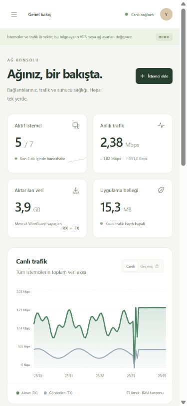
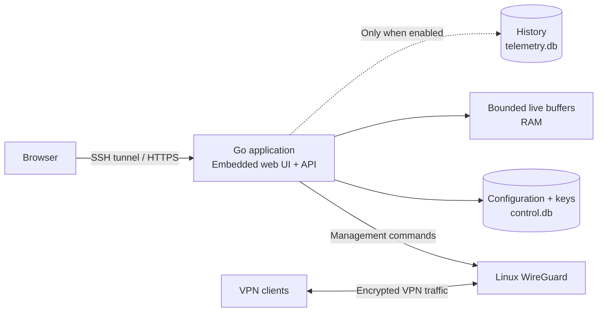

<p align="center">
  
</p>

<p align="center">
  <a href="INSTALL.md">Installation guide</a> · <a href="https://github.com/barkinarga/Wireguard-Simple/releases/latest">Download</a> · <a href="#preview">Preview</a>
</p>

<p align="center">
  <a href="https://github.com/barkinarga/Wireguard-Simple/actions/workflows/build-release.yml"></a>
</p>

# WireGuard Simple

A lightweight WireGuard management console for Debian, Ubuntu, RHEL, CentOS Stream, AlmaLinux, Rocky Linux, and Fedora, with an original interface, live monitoring, and optional history. Built independently in Go and TypeScript.

The compiled interface is embedded in the Go application. Your server needs **one application, WireGuard tools, nftables, and systemd**. No Node.js, separate frontend server, or database service is required at runtime.

**Early development release:** builds, automated tests, and installer checks run in Linux CI. The interface startup fix was tested on an Ubuntu 26.04.1 ARM64 KVM server, including a real WireGuard handshake, internet ping, DNS and HTTPS from a temporary VPN client namespace on the same host. External-device connectivity, full-machine reboot recovery, SELinux enforcement, and resource use across target distributions still need end-to-end validation.

## Languages

The application starts in **English** and includes **10 embedded interface languages**: English, Turkish, German, French, Spanish, Italian, Portuguese, Russian, Arabic, and Simplified Chinese. Change language in the top bar or before sign-in. Your choice is remembered in this browser, and unsaved form fields are preserved when switching.

Arabic includes a right-to-left layout. Dates, numbers, and relative times follow the selected language. Common validation messages and administrative events are translated; low-level WireGuard/OS diagnostics remain in English. Client names, keys, and configurations are never translated. No external translation service is used.

Repository documentation is maintained in **English**. [Translation maintenance](docs/localization.md).

## Preview


*Desktop demo. All displayed clients, addresses, traffic, and server details are synthetic sample data. These screenshots are not performance benchmarks.*

<details>
<summary>Mobile preview</summary>
<br>

</details>

## What you can do

| Area | Features |
| --- | --- |
| Manage clients | Create clients, allocate IPv4 addresses, generate keys, download configurations, and display locally generated QR codes. Pause, resume, delete, or set an expiry date. |
| Observe the server | View traffic rates, recent handshakes, client counters, system health, and application memory from one dashboard. |
| Configure WireGuard | Set endpoint, subnet, port, DNS, MTU, and client AllowedIPs. Import a server configuration with validation; executable hooks are rejected. |
| Choose persistence | Enable traffic history and administrative event history separately, with retention and storage limits. Clear history without deleting client settings. |
| Export metrics | Optionally enable Prometheus with a separate, read-only access token. |
| Control access | First-run setup token, administrator login, Argon2id password hashing, expiring sessions, CSRF checks, and login rate limits in live mode. |

## Install with one command

Run this on a **supported Linux server** with systemd and `curl` available:

```bash
curl -fL --retry 3 -o wgsimple-install.run https://github.com/barkinarga/Wireguard-Simple/releases/latest/download/wgsimple-install.run && sudo bash wgsimple-install.run
```

The installer selects **amd64 or arm64**, checks the embedded payload's SHA-256, installs missing system tools, and starts the management service. A fresh installation listens on all IPv4 interfaces on TCP 8787 and prints both loopback and a detected server address. Open `http://SERVER_IP:8787` directly, or use an SSH tunnel:

```bash
ssh -L 8787:127.0.0.1:8787 user@server
```

Open **http://127.0.0.1:8787** on your computer. On the server, read the first-run token and use it to create your administrator account:

```bash
sudo cat /var/lib/wgsimple/setup-token
```

**Fresh installations also prepare IPv4 forwarding, subnet-scoped NAT and automatic WireGuard startup.** The uplink is detected from the default IPv4 route. Active UFW/firewalld or custom input/forward rules require administrator-managed setup with `--no-network`; the installer stops with an explanation instead of silently reporting success. Existing installations retain their networking unless you request `--configure-network`. Set the public endpoint in Settings and allow the VPN UDP port in your provider firewall (default 51820). Direct panel access also requires TCP 8787 to be allowed by your host/provider firewall. HTTP is unencrypted; use the SSH tunnel or configure HTTPS on untrusted networks.

Full steps, upgrades, offline file transfer, and troubleshooting: **[Installation guide](INSTALL.md)**.

## Linux distributions

| Distribution | Installer package path | Requirements |
| --- | --- | --- |
| Debian / Ubuntu | `apt-get`, `iproute2` | WireGuard-capable kernel and systemd |
| RHEL / AlmaLinux / Rocky Linux | `dnf`, or `yum` fallback; `iproute` | EL8 or newer; EL8 may require a separately prepared WireGuard kernel/module |
| CentOS Stream | `dnf`, `iproute` | Stream 9 or newer; retired CentOS Linux and Stream 8 are rejected |
| Fedora | `dnf`, `iproute` | Mutable system with systemd; ostree/CoreOS/Silverblue-style images require a separate deployment method |

The installer checks kernel support without creating interfaces or loading modules. It uses enabled repositories, preserves existing `curl` providers, and never adds EPEL/ELRepo, replaces a kernel, disables SELinux, or changes firewalld rules. When available, `restorecon` restores policy labels on installed paths. Package/kernel prerequisites and the distinction between mocked installer tests and real distro validation are described in [platform notes](docs/platforms.md).

## Panel access

In **Settings → Panel access**, choose public access, this server only (loopback/SSH tunnel), or private networks only. An optional IP/CIDR allowlist further restricts non-loopback clients. Changes apply immediately and may disconnect you; the confirmation reminds you to keep SSH available. These are HTTP admission rules; the listening socket remains bound and blocked sources receive HTTP 403. VPN traffic is unaffected.

Recover through SSH by stopping the service, resetting only its panel policy, then starting it again. See [recovery and upgrade steps](INSTALL.md#panel-access-and-recovery). Existing installations retain their service listener on upgrade.

## Lightweight by default

Live information stays in bounded memory buffers. Persistent recording is opt-in.

| Setting | Default |
| --- | --- |
| Live monitoring | On |
| Traffic samples in memory | Last 120 samples |
| Administrative events in memory | Last 200 events |
| Persistent traffic history | Off |
| Persistent administrative history | Off |
| Prometheus endpoint | Off |
| Retention when history is enabled | Up to 7 days |
| History storage budget | 32 MB |
| Persistent sampling interval | 60 seconds |

History settings allow 16–512 MB, 1–30 days, and 30–3600-second sampling. The storage budget can cause older records to expire before the retention period. Recording pauses below 64 MB of free disk space; recording errors do not stop WireGuard traffic.

`control.db` stores configuration and client keys. A separate `telemetry.db` is created only when persistent recording is needed. Turning recording off retains existing history until cleanup or explicit deletion. Operating system logs and administrator backups are outside this history budget. The supplied systemd unit does not persist the application's stdout/stderr.

Release binaries are approximately **12 MB per architecture**; system packages are additional. The memory card reports Go runtime memory, not process RSS. Small-server resource consumption has not yet been benchmarked.

## How it fits together



The Go application manages the VPN; VPN packets flow through Linux WireGuard. Stopping the panel leaves an existing WireGuard interface running, but monitoring and expiry enforcement require the panel service to run.

## Try the Windows demo

From the project folder in PowerShell, with development dependencies installed:

```powershell
.\start-demo.ps1
```

Visit **http://127.0.0.1:8787**. Stop with Ctrl+C. Demo mode uses synthetic data and only listens on loopback. It does not install or invoke WireGuard, or change Windows networking, DNS, firewall rules, or services. Demo files stay in `.data/demo/`, separate from live data.

## Build from source

Development requires **Go 1.26+ and Node.js**. CI currently uses Go 1.27.3 and Node.js 24. These build tools are not needed on the target server.

```powershell
npm.cmd ci
.\scripts\build.ps1 -All
```

This produces Windows and Linux binaries plus `release/wgsimple-install.run`, containing both Linux architectures. On Linux, use `npm ci` followed by `sh scripts/build.sh` to build the application.

```bash
npm run check
npm run test:i18n
go test ./... -count=1
go vet ./...
```

Linux CI also runs Go tests with the race detector, isolated installer scenarios, and package-integrity tests. Installer tests use mock package and service managers; they do not establish real VPN connectivity.

## Current scope and limits

- One WireGuard interface per application/data directory; automatic address allocation is IPv4. Multi-server management and comprehensive IPv6 support are not implemented.
- Activity is inferred from recent handshakes. WireGuard does not provide exact login/logout events or browsing history. There is no packet capture or visited-site logging.
- Counters can reset when an interface is recreated. History is operational monitoring, not a billing meter; the chart shows up to 360 stored samples.
- Fresh startup directly configures the interface with `ip` and `wg`, preserving service restrictions on systems with confined `wg-quick` helpers. For routed client subnets outside the server VPN network, start the interface externally and import its running configuration.
- Imported server files do not contain client private keys, so imported clients cannot receive regenerated configurations or QR codes from those files alone.
- Live interface address/MTU changes require maintenance. Existing executable configuration hooks are not automatically managed.
- The initial Linux service runs as root with capability and filesystem restrictions. Configuration and keys are protected by file permissions, without application-level disk encryption.
- OIDC, two-factor authentication, roles, and notification integrations are not implemented. The optional Docker configuration has not been runtime-tested.

## License

[GNU AGPL-3.0](LICENSE). Third-party dependency licenses are listed in [THIRD_PARTY_NOTICES.md](THIRD_PARTY_NOTICES.md).
