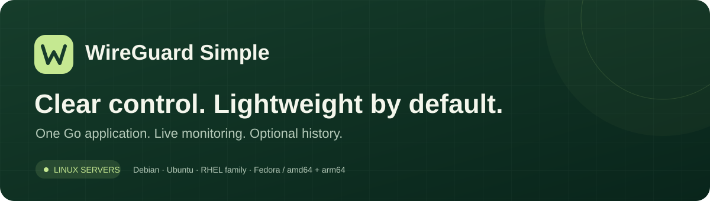
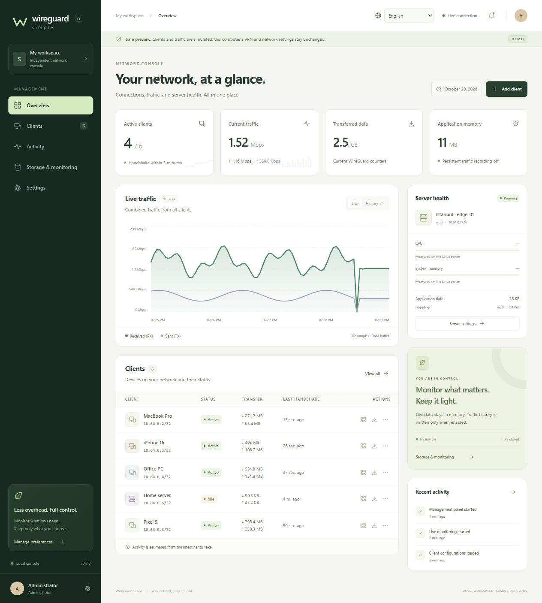

<p align="center"></p>

[English](README.md) · **Türkçe** · [Kurulum kılavuzu](KURULUM.md)

# WireGuard Simple

Bağımsız kaynak kodu ve arayüzüyle, hafif bir WireGuard yönetim konsolu. Go sunucusu, derlenmiş TypeScript/CSS arayüzünü kendi içinde taşır. Hedef Linux sunucusunda Node.js, npm, ayrı bir web sunucusu veya ayrı veritabanı servisi gerekmez.

**Durum:** ilk çalışan geliştirme sürümü. Windows'ta yalnızca güvenli demo çalıştırılır. Linux/amd64 ve Linux/arm64 için tek dosyalık uygulama derlenir. Gerçek Linux WireGuard bağlantısı ve yönlendirme, hedef test sunucusunda ayrıca doğrulanmalıdır; bu sürüm için üretim doğrulaması yapılmış olduğu iddia edilmez.

## Dil desteği

Uygulamanın varsayılan dili **İngilizce**. Üst çubuktan veya giriş ekranından **İngilizce, Türkçe, Almanca, Fransızca, İspanyolca, İtalyanca, Portekizce, Rusça, Arapça ve Basitleştirilmiş Çince** seçilebilir. Tercih bu tarayıcıda hatırlanır; dil değişirken kaydedilmemiş form alanları korunur. Arapçada sağdan sola düzen kullanılır; tarih, sayı ve göreli süreler seçilen dile uyar.

Çeviriler uygulamaya gömülüdür; ek servis veya internet gerektirmez. Sık kullanılan doğrulama ve olay mesajları çevrilir; düşük seviyeli WireGuard/işletim sistemi tanı ayrıntıları İngilizcedir. İstemci adları, anahtarlar ve yapılandırma dosyaları çevrilmez. Repo açıklamaları ve kurulum belgeleri İngilizce/Türkçe olarak tutulur.

## Linux dağıtımları

Kurucu **Debian, Ubuntu, RHEL, AlmaLinux, Rocky Linux, CentOS Stream ve Fedora** sistemlerini tanır. Debian/Ubuntu için `apt-get` ve `iproute2`; RPM tabanlı sistemlerde `dnf` (RHEL ailesinde gerektiğinde `yum`) ve `iproute` kullanılır. RHEL/Alma/Rocky için EL8+, CentOS için Stream 9+ gerekir. Eski CentOS Linux 7/8 ve Stream 8 ile değiştirilemez ostree tabanlı sistemler bu kurucunun kapsamı dışındadır.

WireGuard çekirdek desteği arayüz oluşturmadan kontrol edilir. EL8'de uygun çekirdek/modülün önceden hazırlanması gerekebilir. Kurucu ek depo açmaz veya çekirdek değiştirmez; SELinux ve firewalld kapatılmaz. Dağıtım kararları ve paket akışları taklit komutlarla test edilir; her dağıtımda gerçek VPN/SELinux testi henüz tamamlanmadı. Ayrıntılar: [Platform notları (English)](docs/platforms.md).

## Görünüm



*Demo ekranı: istemciler, adresler, trafik ve sunucu bilgileri uygulamanın ürettiği örnek verilerdir. Görseldeki değerler performans ölçümü değildir.*

[Mobil ekran görüntüsü](docs/screenshots/mobile.png)

## Hızlı kurulum

Basit adımlar: **[KURULUM.md](KURULUM.md)**. Hedef desteklenen Linux sunucusunda:

```bash
curl -fL --retry 3 -o wgsimple-install.run https://github.com/barkinarga/Wireguard-Simple/releases/latest/download/wgsimple-install.run && sudo bash wgsimple-install.run
```

Kurucu amd64/arm64 mimarisini seçer, gömülü paketin SHA-256 bütünlüğünü doğrular, eksik araçları kurar ve paneli başlatır. Panel loopback adresinde kalır; SSH tüneliyle açılır. NAT/forwarding/DNS/güvenlik duvarı ve mevcut VPN arayüzleri değiştirilmez. Yeni kurulumda geçmiş/log/metrikler kapalıdır. `curl` yoksa kılavuzdaki dosya aktarımı yolunu kullanın.

## Yerel demoyu açma

Proje klasöründeki PowerShell'den:

```powershell
.\start-demo.ps1
```

Tarayıcı adresi: **http://127.0.0.1:8787**. Durdurmak için Ctrl+C.

- WireGuard kurmaz, başlatmaz veya çağırmaz.
- DNS, ağ yönlendirmesi, güvenlik duvarı ve Windows servisleri değişmez.
- İstemciler, adresler ve trafik açıkça işaretlenmiş örnek verilerdir.
- Demo yalnızca loopback adresinde dinler. Ağ üzerinden yayınlanması reddedilir.
- Demo kayıtları yalnızca `.data/demo/` içinde tutulur. Demo ve canlı mod aynı veri klasörünü kullanamaz.
- Özel anahtarlar demo için yerel olarak üretilir; herhangi bir gerçek sunucuya erişim sağlamaz.

## Bu sürümde çalışanlar

- Genel bakış, toplam trafik grafiği, istemci durumu ve uygulama kaynak göstergeleri.
- İstemci oluşturma, otomatik IP dağıtma, bağımsız X25519 anahtar çifti ve preshared key.
- Yapılandırma indirme ve yerel QR üretimi; haricî QR servisi kullanılmaz.
- İstemci erişimini duraklatma/etkinleştirme, silme ve bitiş tarihi.
- Sunucu endpoint, DNS, MTU, alt ağ, port ve istemci AllowedIPs ayarları.
- Sunucu `.conf` dosyasından kontrollü içe aktarma. Hook ve çalıştırılabilir yönergeler reddedilir.
- Ortak bir toplayıcı üzerinden canlı izleme. Sayaç sıfırlanması negatif veya devasa hız üretmez.
- Son 120 trafik örneği ve son 200 yönetim olayı için sınırlı RAM tamponu.
- İsteğe bağlı kalıcı trafik ve yönetim geçmişi; geçmiş temizleme, süre ve disk bütçesi.
- İsteğe bağlı Prometheus uç noktası ve yalnızca metrik okumaya yetkili Bearer anahtarı.
- Canlı modda ilk kurulum anahtarı, Argon2id parolası, süreli oturum, CSRF/Origin/Host kontrolleri ve giriş denemesi sınırı.
- Mobil menü, duyarlı düzen, klavye ile gezinme ve istemci araması için `/` kısayolu.

## Hafif varsayılanlar

| Tercih | Varsayılan |
| --- | --- |
| Canlı izleme | Açık, son örnekler RAM'de |
| Kalıcı trafik geçmişi | Kapalı |
| Kalıcı yönetim geçmişi | Kapalı |
| Prometheus uç noktası | Kapalı |
| Geçmiş açıkken saklama üst sınırı | 7 gün |
| Toplam geçmiş dosyası bütçesi | 32 MB |
| Geçmiş örnekleme aralığı | 60 saniye |
| Panel görüntülenirken toplama | Yaklaşık 3 saniye |
| Panel kullanılmıyorken toplama | Yaklaşık 30 saniye |

`control.db` ayarları ve istemci anahtarlarını taşır; `telemetry.db` yalnızca kayıt gerektiğinde oluşturulur. Geçmişe özel anahtar veya parola yazılmaz. Yapılandırma dosyaları ve SQLite kayıtları Linux'ta `0600`, veri klasörü `0700` izinleriyle korunur. Diskte şifreleme bu sürümde ayrıca sağlanmaz; sunucu/disk erişiminin güvenliği sistem yöneticisine aittir.

Geçmiş için 16–512 MB bütçe, 1–30 gün ve 30–3600 saniye aralık seçilebilir. Süre bir **üst sınırdır**: disk bütçesine önce ulaşılırsa daha eski kayıtlar daha erken silinir. SQLite DELETE journal kullanılır; bütçenin yarısı veritabanına, kalan kısmı geçici işlem günlüğü ve paya ayrılır. Sorgu geçici alanı RAM'dedir. SQLite cache'leri sınırlıdır; geçmiş dosyası silinince yapılandırma verisi korunur.

Boş alan 64 MB altına düşerse kalıcı kayıt duraklatılır. Kayıt hataları panelde gösterilir ve WireGuard trafiğini durdurmaz. Kayıtları kapatmak var olan geçmişi hemen silmez; temizleme işlevi veya süre temizliği kullanılabilir. Sistem yöneticisinin kendi yedekleri ve işletim sisteminin servis yöneticisi günlükleri uygulamanın geçmiş bütçesine dahil değildir. Verilen systemd birimi uygulama stdout/stderr akışını kalıcı günlüğe yazmaz.

Uygulama belleği göstergesi Go çalışma zamanının ayırdığı bellektir (`runtime.MemStats.Sys`); işletim sistemi RSS ölçümü veya tüm sunucunun bellek tüketimi değildir. Linux sistem belleği ve CPU göstergeleri `/proc` üzerinden ayrıca okunur. Paket boyutu, boşta tüketim ve yoğun kullanım birbirinden ayrı ölçülmelidir.

## Linux sunucusunda çalıştırma

Bu komutlar **hedef Linux test sunucusu** içindir. Windows bilgisayarında çalıştırılmaz.

Ön koşullar: WireGuard destekli Linux çekirdeği, `wireguard-tools`, `iproute2` ve systemd. Örnek dağıtım kurulumu:

```bash
sudo apt update
sudo apt install wireguard-tools iproute2
```

Doğru mimariye ait `bin/wgsimple-linux-amd64` veya `bin/wgsimple-linux-arm64` dosyasını sunucuya kopyalayın. Paketi ve yönetim servisini kurun:

```bash
sudo bash scripts/install-linux.sh ./bin/wgsimple-linux-amd64
sudo systemctl enable --now wgsimple.service
```

Kurucu eksik paketleri tamamlar ve yönetim servisini başlatır. DNS, NAT, IP forwarding veya güvenlik duvarı değiştirmez; WireGuard arayüzünü başlatmaz/durdurmaz. Yönetim paneli yalnızca `127.0.0.1:8787` üzerinde dinler. Eski `install-linux.sh` adı uyumluluk girişidir; yanında `install.sh` bulunmalıdır.

Kendi bilgisayarınızdan SSH tüneli açın:

```bash
ssh -L 8787:127.0.0.1:8787 user@server
```

Tarayıcıdan `http://127.0.0.1:8787` adresine girin. Sunucuda ilk kurulum anahtarını **yalnızca kendiniz okuyun**:

```bash
sudo cat /var/lib/wgsimple/setup-token
```

Kurulum ekranında bu anahtarı kullanarak yönetici hesabını oluşturun. Hesap açılınca anahtar dosyası kaldırılır. Parola değiştirmek mevcut oturumları kapatır. Hazır veya ortak bir yönetici parolası bulunmaz.

### Yeni VPN veya mevcut VPN

Yeni sunucuda önce endpoint ve diğer ayarları panelden belirleyin. Canlı moddaki açık bir yönetim işlemi, mevcut olmayan `wg0` arayüzü için yönetilen `.conf` dosyasını üretip `wg-quick` ile arayüzü başlatabilir. Bu nedenle canlı mod yalnızca yönetilecek Linux sunucusunda çalıştırılır. Panelin kendisi ilk açılışta otomatik VPN değişikliği yapmaz.

Mevcut arayüzde farklı bir sunucu anahtarı varsa uygulama değişiklik yapmayı reddeder. Önce uygun sunucu yapılandırmasını içe aktarın. İçe aktarma çalışan arayüze bağlanır; arayüzü yeniden başlatmaz. İstemci özel anahtarları sunucu `.conf` dosyasında bulunmadığı için içe aktarılan istemciler için yeni QR/yapılandırma üretilemez.

Peer ve port değişikliklerinde `wg syncconf` kullanılır. Çalışan arayüzün adres/MTU değişikliği bakım gerektirir ve bu sürümde panelden kesintisiz uygulanmaz. Hook içeren mevcut dosyalar otomatik yönetilmez; bu yönergelerin etkisi Linux yöneticisi tarafından ayrıca ele alınmalıdır.

İnternete çıkış veya başka ağlara yönlendirme için sunucudaki forwarding, NAT ve güvenlik duvarı politikası ayrıca hazırlanmalıdır. Panel bunu sessizce değiştirmez. Başarıyla oluşturulan yönetilen VPN'in reboot sonrası açılması, yapılandırma doğrulandıktan sonra sunucuda ayrıca etkinleştirilebilir:

```bash
sudo systemctl enable wg-quick@wg0.service
```

Yönetim panelini kapatmak WireGuard arayüzünü kapatmaz. Peer bitiş tarihleri ve izleme ise panel servisi çalışırken denetlenir; servis kapalıyken bitiş tarihi zorla uygulanamaz. Bitiş tarihi kontrolünde normal koşullarda yaklaşık 30 saniyeye kadar gecikme olabilir.

### HTTPS ve metrikler

Genel ağda doğrudan HTTP dinlemek reddedilir. Doğrudan dış erişim için canlı mod, TLS dosyaları ve açıkça belirtilmiş HTTPS origin gerekir:

```bash
wgsimple --mode live --data-dir /var/lib/wgsimple \
  --listen 0.0.0.0:8787 \
  --origin https://vpn.example.com:8787 \
  --tls-cert /path/fullchain.pem --tls-key /path/privkey.pem
```

HTTPS reverse proxy de loopback arkasında kullanılabilir: panelin `--origin` değeri dışarıdaki HTTPS adresi olmalı, proxy Host başlığını korumalıdır. Uygulama istemci IP'si için gelişigüzel `X-Forwarded-For` başlığına güvenmez. Tek proxy arkasında giriş sınırı proxy adresini paylaşır; proxy tarafında uygun ek sınırlar uygulanmalıdır.

Prometheus tercihini açıp kaydettikten sonra panelden salt okunur erişim anahtarı oluşturun. Anahtar yalnızca oluşturulduğunda gösterilir, veritabanında SHA-256 özeti saklanır. Örnek scraper:

```yaml
scrape_configs:
  - job_name: wireguard-simple
    scrape_interval: 30s
    static_configs:
      - targets: ['127.0.0.1:8787']
    authorization:
      type: Bearer
      credentials_file: /secure/path/wgs-metrics-token
```

## İsteğe bağlı Docker yolu

`Dockerfile` ve `compose.yaml` yalnızca hedef **Linux sunucusu** içindir. Son image Node.js veya Go derleyicisi taşımaz. Host ağ alanı kullanılır; bu nedenle mevcut VPN'in ömrü panel container'ına bağlı olmaz. Yönetim HTTP adresi yine loopback'tir. Yalnızca `NET_ADMIN` yetkisi verilir, container kök dosya sistemi salt okunurdur, container log yazımı kapalıdır ve belleği sınırlıdır.

```bash
sudo docker compose up -d --build
sudo docker compose exec wgsimple cat /var/lib/wgsimple/setup-token
```

Bu yol ilk geliştirme ortamında Docker bulunmadığı için çalıştırılarak doğrulanmadı. Windows'ta Docker veya WireGuard kurulumu yapılmadı. Ana doğrulanan paketleme yolu tek dosyalık uygulamadır.

## Derleme ve kontroller

Geliştirme için Go 1.26+ ve Node.js gerekir. Bunlar hedef sunucuda gerekmez. İndirilen geliştirme araçları `.tools/` içinde ve paketlerden ayrıdır.

```powershell
npm.cmd ci
.\scripts\build.ps1 -All
```

`-All`, iki Linux mimarisini ve `release/wgsimple-install.run` evrensel kurucusunu da hazırlar. Linux uygulamaları zaten derlenmişse yalnızca kurulum paketini yenilemek için `npm run package:linux`, paket kontrolleri için `npm run test:package` kullanılabilir.

Linux üzerinde:

```bash
sh scripts/build.sh
```

Kontroller:

```bash
npm run check
go test ./... -count=1
go vet ./...
```

Paketlerde haricî web fontu, CDN, analitik izleyici veya çalışma zamanında npm bağımlılığı yoktur. UI varlıkları `internal/web/dist/` içine derlenir ve Go `embed` ile taşınır. `bin/` çıktıları ve `.tools/` geliştirme önbelleği Git kapsamı dışında tutulur.

## Mevcut sınırlar

- Bir uygulama/veri klasörü tek WireGuard arayüzünü yönetir. Otomatik IP dağıtımı IPv4 içindir; kapsamlı IPv6 ve çok sunucu yönetimi henüz eklenmedi.
- Trafik geçmişinde grafik son 360 kalıcı örneği gösterir. İstemci bazlı sınırlı sayaç örnekleri saklanır; ayrıntılı geçmiş sorgulama ekranı sonraki geliştirme alanıdır.
- WireGuard kesin bağlandı/ayrıldı oturum olayları veya ziyaret edilen siteler vermez. Aktiflik son handshake'e dayanan tahmindir; istemcinin boşta olması kopmuş olduğu anlamına gelmez.
- Sayaçlar WireGuard arayüzü yeniden oluşturulunca sıfırlanabilir. Kalıcı örnekleme araları arasında gerçekleşen reset öncesi trafik tam olarak geri çıkarılamaz. Bu sürüm faturalandırma ölçeri değildir.
- Paket/akış yakalama, ziyaret geçmişi, OIDC, 2FA, rol yönetimi ve bildirim entegrasyonları henüz uygulanmadı.
- Canlı adaptör Linux ağ yönetimi yetkisi gerektirir. İlk systemd birimi root UID ile, `CAP_NET_ADMIN` sınırı ve dosya sistemi kısıtlarıyla çalışır; ayrı yetkili yardımcı sürece ayırma sonraki sertleştirme alanıdır.
- Linux çekirdeğiyle gerçek bağlantı, NAT, yeniden başlama ve düşük disk testleri hedef test sunucusunda tamamlanmalıdır.

Araştırma ve mimari kararlar: [docs/architecture.md](docs/architecture.md).

Kurucu kontrolleri: [docs/installation-validation.md](docs/installation-validation.md). Proje lisansı: [LICENSE](LICENSE); bağımlılık bildirimleri: [THIRD_PARTY_NOTICES.md](THIRD_PARTY_NOTICES.md).
